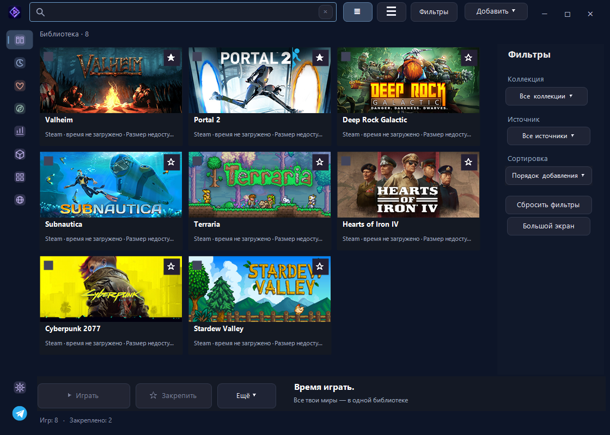
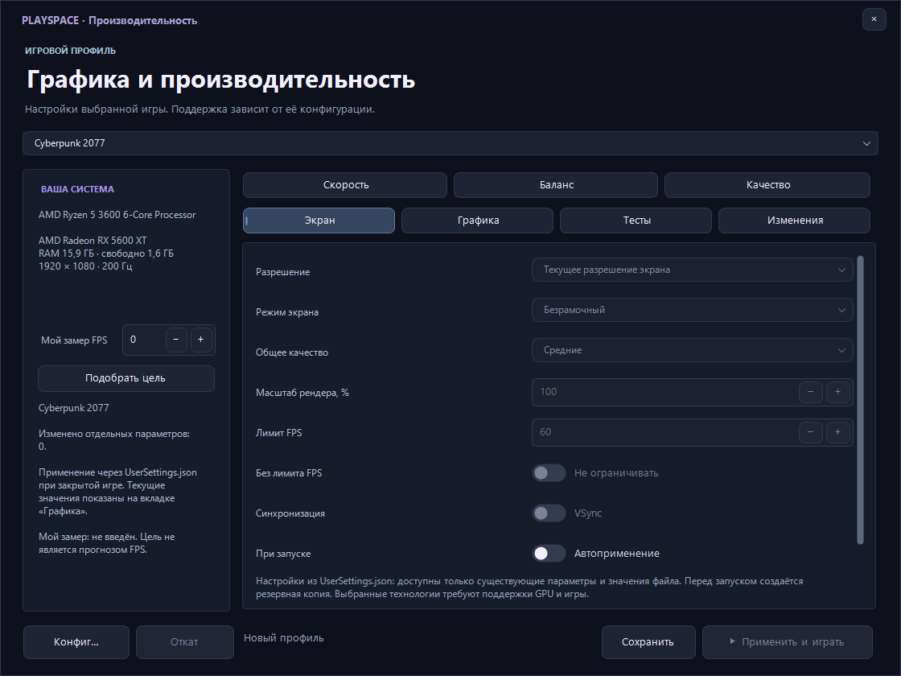
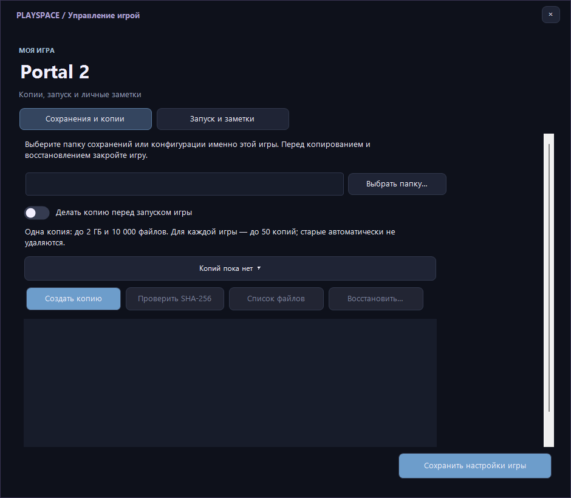
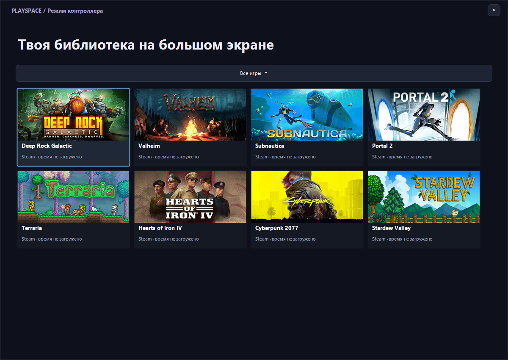

<p align="center">
  
</p>

# LauncherPlaySpace

**Бесплатный игровой лаунчер для Windows: библиотека игр, статистика Steam, моды и настройки графики в одном приложении.**

LauncherPlaySpace (PlaySpace) объединяет установленные игры в одной библиотеке. Запускай игры Steam и локальные проекты, собирай коллекции, устанавливай поддерживаемые моды, сохраняй игровые профили и находи, во что поиграть дальше.

[Скачать для Windows](https://github.com/d3a0g/playspace-releases/releases/latest) · [Скриншоты](#скриншоты) · [Документация](docs/README.md) · [Поддержка](https://t.me/PlaySpaceSupport_bot)

**English:** A free, open-source Windows game launcher with a unified library, Steam playtime and achievements, mod management, save backups and supported per-game graphics profiles.



## Возможности

| Раздел | Что доступно |
| --- | --- |
| Библиотека | Поиск установленных игр Steam и Epic Games, ручное добавление EXE, закрепления, коллекции, теги и недавние запуски. |
| Оформление | Сетка обложек и компактный список, поиск, фильтры, сортировка, свои иконки, настройки текста, цвета и анимаций. |
| Статистика Steam | Общее время игры и достижения подключённого профиля; локальный счётчик для игр вне Steam. |
| Рекомендации | Подборка игр по жанрам, закрепления, описания и скриншоты Steam, переход в официальный магазин. |
| Моды | Каталоги Thunderstore, зависимости, импорт поддерживаемых ZIP-модов, наборы модов и управление модами стратегий Paradox. |
| Графика | Профили для отдельных игр, поддерживаемые параметры запуска и конфигурации, предпросмотр изменений и откат. |
| Сохранения и файлы | Резервные копии выбранных папок, проверка целостности, восстановление, поиск дубликатов и перенос игры. |
| Загрузки | Очередь, прогресс, отмена, повтор и ограничение скорости загрузок лаунчера. |
| Удобство | Работа в трее, выбор действия крестика, помощник запуска, большой экран с управлением геймпадом и офлайн-кеш. |

## Установка

Нужны **Windows 10 или Windows 11 x64**. Готовая сборка содержит среду .NET: отдельно устанавливать её не требуется.

1. Открой [страницу скачивания](https://github.com/d3a0g/playspace-releases/releases/latest).
2. Выбери установщик **LauncherPlaySpace-…-Setup.exe** и запусти его.
3. Открой лаунчер через созданный ярлык.
4. Найди установленные игры или добавь EXE вручную.

Для переносного запуска скачай **LauncherPlaySpace-…-win-x64.zip**, распакуй его в отдельную папку и открой `LauncherPlaySpace.exe`.

Игры и игровые клиенты устанавливаются отдельно. Лаунчер не содержит игры и не предоставляет лицензии на них.

[Все выпуски и списки изменений](https://github.com/d3a0g/playspace-releases/releases) доступны в Releases.

## Скриншоты

Снимки сделаны в версии **1.0.6** с демонстрационной библиотекой и публичными обложками Steam. Личные аккаунты не используются; внешний вид может отличаться в зависимости от настроек.

### Рекомендации


<details>
<summary>Графика, сохранения и большой экран</summary>







</details>

## Подключение Steam

В **Настройки → Профиль Steam** укажи SteamID64 и личный Steam Web API key. Время и достижения обновляются для всей доступной библиотеки. Если включено запоминание, ключ хранится в защищённом хранилище Windows.

Статистика зависит от настроек приватности Steam и доступности API. Общее время Steam не складывается с локальным счётчиком. Для игр вне Steam время учитывается, пока работает лаунчер, включая трей.

## Моды и графика

Поддержка зависит от конкретного игрового адаптера. Для совместимых игр доступны каталоги Thunderstore, установка зависимостей и переключение управляемых наборов. Для стратегий Paradox предусмотрены импорт ZIP, регистрация уже скачанных Workshop-модов и настройка порядка загрузки.

Параметры графики применяются только там, где реализована поддержка игры. Перед изменением поддерживаемых конфигураций создаются резервные копии. Выбранный профиль не гарантирует заданный FPS; совместимость модов и экспериментальных DLSS-функций зависит от игры, её версии и оборудования.

[Управление модами](docs/features/mods/MODS.md) · [Настройки графики](docs/features/performance/PERFORMANCE.md) · [Сохранения и резервные копии](docs/features/savegames/GAME-CARE.md)

## Данные и безопасность

Библиотека и настройки хранятся локально в `%LOCALAPPDATA%\GameLauncherPRO`. Они находятся отдельно от установленного EXE. Перед переносом настроек или восстановлением файлов сделай резервную копию.

Для обложек, описаний, статистики, проверки версии и загрузки компонентов приложение обращается к соответствующим внешним сервисам. Доступные сохранённые данные можно использовать в офлайн-режиме.

Моды и дополнительные компоненты не становятся доверенными только потому, что установлены через лаунчер. Проверяй источник и требования автора. Системные предупреждения Windows не отключаются. Отчёты сканирования относятся к конкретным файлам и их хешам.

[Безопасность и отчёты](docs/security/README.md) · [Сообщить об уязвимости](SECURITY.md) · [Лицензии сторонних компонентов](THIRD_PARTY_NOTICES.md)

## Поддержка и предложения

Напиши **[@PlaySpaceSupport_bot](https://t.me/PlaySpaceSupport_bot)** или создай [issue](https://github.com/d3a0g/LauncherPlaySpace/issues).

В сообщении об ошибке укажи версию приложения, название игры, действие перед сбоем и текст ошибки. Скриншот поможет воспроизвести проблему. Не отправляй пароли, API-ключи и коды подтверждения.

## Разработка

Добровольная поддержка автора не предусматривает встречных услуг или бонусов. Подключение приёма платежей через Robokassa пока не завершено; действующая платёжная ссылка здесь не размещена.

Проект написан на **C# / .NET 10 / Windows Forms**. Для сборки нужны Windows и .NET SDK 10.

```powershell
dotnet build GameLauncherGUI/GameLauncherGUI.csproj -c Release
dotnet run --project GameLauncherGUI/GameLauncherGUI.csproj -c Release
```

Проверки логики и интерфейса:

```powershell
dotnet run --project GameLauncherGUI.Tests/GameLauncherGUI.Tests.csproj -c Release -- --ui
```

| Каталог | Назначение |
| --- | --- |
| [GameLauncherGUI](GameLauncherGUI) | Приложение Windows Forms. |
| [GameLauncherGUI.Tests](GameLauncherGUI.Tests) | Автоматические проверки и тестовые данные. |
| [PlaySpace.SupportBot](PlaySpace.SupportBot) | Отдельный обработчик поддержки Telegram. |
| [docs](docs) | Пользовательская и инженерная документация. |
| [tools](tools) | Инструменты сборки и сопровождения. |

Токены, личная библиотека, конфигурация бота и обращения пользователей в исходники не включаются.

[Участие в разработке](CONTRIBUTING.md) · [Структура проекта](docs/engineering/ARCHITECTURE.md)

## Лицензия

Оригинальный код распространяется по [лицензии MIT](LICENSE). Игры, изображения магазинов, моды и сторонние компоненты сохраняют собственные лицензии.

Авторские права (c) 2026 d3a0g<br>
Copyright (c) 2026 d3a0g

LauncherPlaySpace — независимый проект, не связанный с Valve, Epic Games или другими владельцами упомянутых сервисов.
