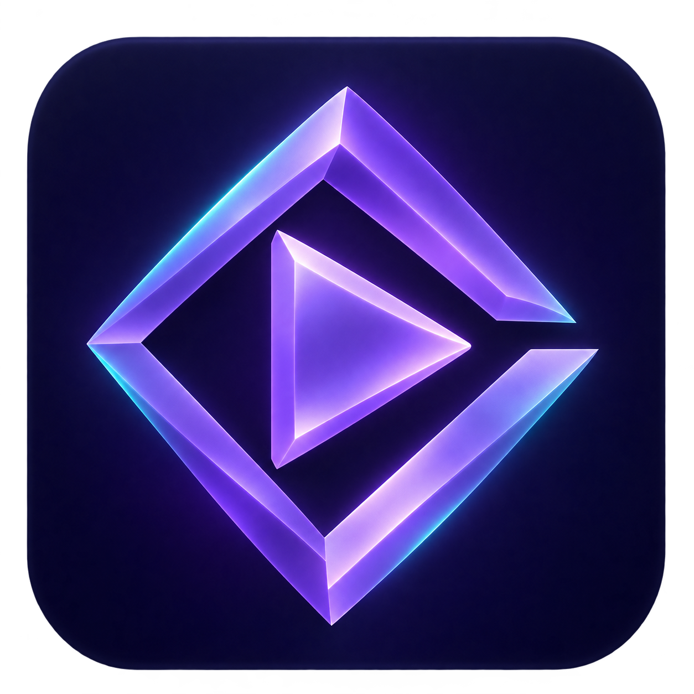
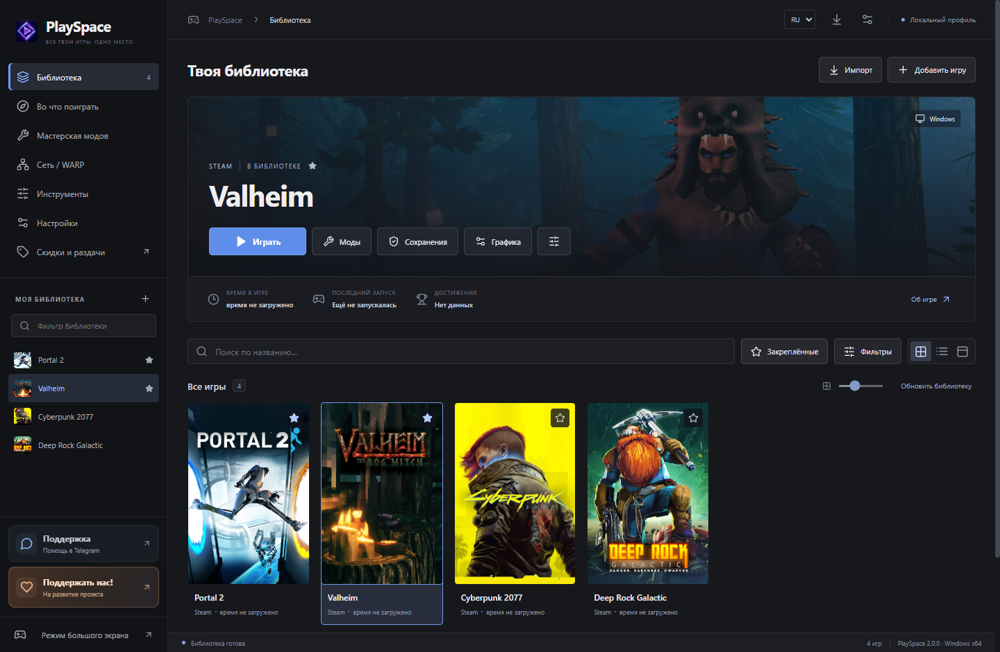
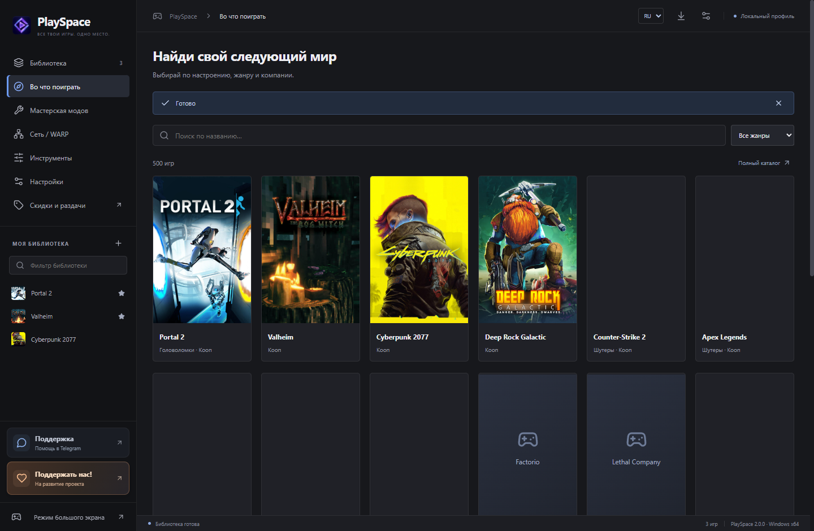
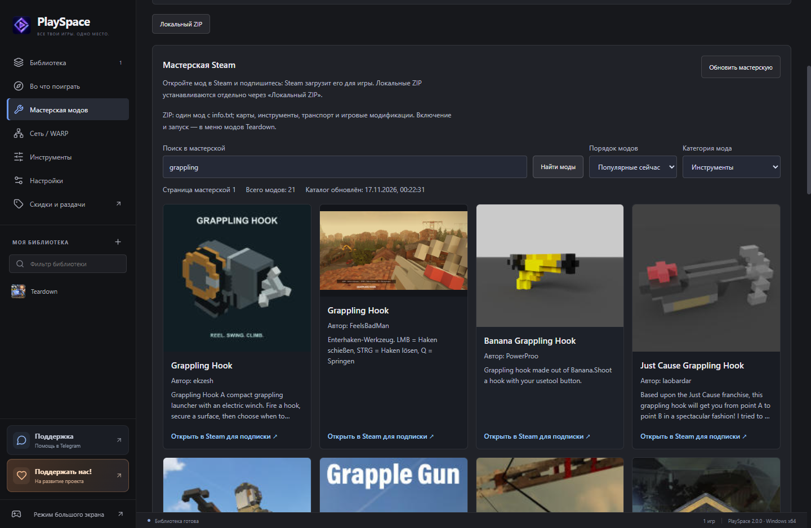
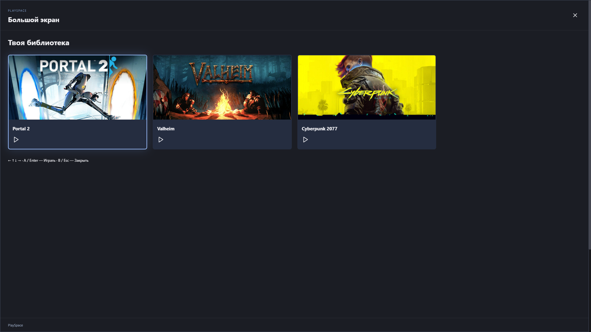

<p align="center">
  
</p>

# PlaySpace 2.0

**Бесплатный игровой лаунчер для Windows: твои игры, моды, сохранения и рекомендации в одном приложении.**

PlaySpace объединяет установленные игры Steam, Epic Games, Riot и локальные EXE в общей библиотеке. Собирай коллекции, выбирай обложки, отслеживай время игры и открывай инструменты выбранной игры прямо в основном окне. Интерфейс доступен на русском и английском.

[Скачать для Windows](https://github.com/d3a0g/playspace-releases/releases/latest) · [Скриншоты](#скриншоты) · [Документация](docs/README.md) · [Telegram](https://t.me/LauncherPlaySpace) · [Поддержка](https://t.me/PlaySpaceSupport_bot)

**English:** PlaySpace is a free, open-source Windows game launcher with a unified library, Russian and English UI, Steam playtime and achievements, mod management, save backups and supported per-game graphics tools. Built with React, TypeScript, Rust and Tauri; the application does not require .NET.



## Возможности

| Раздел | Что доступно |
| --- | --- |
| Библиотека | Поиск установленных Steam/Epic/Riot игр, ручное добавление EXE, закрепления, коллекции, поиск, фильтры и сортировка. |
| Оформление | Сетка, список и подробное представление, размер обложек, собственные изображения, RU/EN и уменьшение анимаций. |
| Запуск и статистика | Запуск через клиент или EXE, аргументы, история и локальный учёт сеансов; время и достижения подключённого профиля Steam. |
| Рекомендации | Популярные игры Steam, поиск и жанры, описания и переход в магазин; скидки Steam и акции Epic с кешем. |
| Мастерская | 78 игровых адаптеров: 36 Thunderstore, 37 локальных и 5 Paradox; зависимости, проверка поддерживаемых ZIP, учёт файлов и профили наборов. |
| Teardown | Публичный Steam Workshop с поиском, категориями и сортировкой; отдельный импорт локального ZIP-мода. |
| Сохранения | Резервные копии выбранных папок, SHA-256, проверка целостности, план восстановления и страховочная копия. |
| Графика | Поддерживаемые параметры запуска и конфигурации отдельных игр, копии и восстановление; инструменты DLSS/OptiScaler с ограничениями совместимости. |
| Инструменты | Загрузки с прогрессом, отменой и лимитом скорости, перенос игры с проверкой копии, диагностика WARP и настройки звуков. |
| Большой экран | Полноэкранная библиотека с клавиатурой и Gamepad API; работа в трее и настройка закрытия окна. |

## Установка

Нужны **Windows 10/11 x64** и **Microsoft Edge WebView2 Runtime**. Игры и игровые клиенты устанавливаются отдельно. Среда .NET для PlaySpace не требуется.

1. Открой [последний выпуск](https://github.com/d3a0g/playspace-releases/releases/latest).
2. Скачай **LauncherPlaySpace-2.0.0-Setup.exe** и выполни установку.
3. Запусти PlaySpace через ярлык. Исполняемый файл — **LauncherPlaySpace.exe**, нативное приложение Rust/Tauri.
4. Найди установленные игры или добавь EXE вручную. RU/EN переключается в верхней панели.

Для запуска без установщика скачай **LauncherPlaySpace-2.0.0-win-x64.zip**, распакуй полностью в отдельную папку и открой **LauncherPlaySpace.exe**. Профиль хранится отдельно от EXE: ZIP не делает пользовательские данные переносными.

[Установка и импорт библиотеки](docs/2.0/INSTALLATION.md) · [Обновления](docs/2.0/UPDATES.md) · [Описание выпуска 2.0.0](docs/releases/2.0.0.md)

## Скриншоты

Интерфейс PlaySpace 2.0 с демонстрационными данными. Изображения игр принадлежат их правообладателям.







## Моды и графика

78 адаптеров описывают поддерживаемые способы установки, а не гарантируют совместимость любого мода с любой версией игры. Thunderstore позволяет просмотреть пакет и зависимости перед установкой. Для Paradox доступны локальные и уже загруженные Workshop-моды, зависимости и порядок загрузки.

В Teardown каталог Workshop предлагает поиск, категории, популярные/новые/лучшие моды и страницы по 30. Сохранённые страницы и превью доступны офлайн. Подписку и загрузку Workshop выполняет **Steam**. PlaySpace устанавливает только импортированные ZIP-моды в фактическую папку Windows Documents/Teardown/mods. Архив должен содержать один мод с `info.txt`. Профили PlaySpace управляют его ZIP-модами; подписки Steam в них не входят. Глобальные моды включаются, а карты запускаются в меню самой Teardown.

Графические инструменты применяют только реализованные для выбранной игры параметры. Они не гарантируют заданный FPS. DLSS, OptiScaler и экспериментальная интеграция UniversalDLSS5 зависят от игры и оборудования; наличие компонента не подтверждает его работу в игровой сессии.

[Мастерская и ограничения](docs/2.0/MODS.md)

## Steam, данные и обновления

В настройках подключи SteamID64 и личный Steam Web API key. Секреты подключения хранятся в Windows Credential Manager. Время и достижения зависят от приватности профиля и доступности API; общее время Steam не складывается с локальным счётчиком. Локальные сеансы учитываются, пока работает PlaySpace, включая трей.

Профиль 2.0: `%LOCALAPPDATA%/io.playspace.next.local`. Импорт из 1.x **копирует библиотеку** из `%LOCALAPPDATA%/GameLauncherPRO`, сохраняя старые данные. Настройки, Steam-секреты и административные разрешения старого клиента автоматически не переносятся. Перед переносом сделай резервную копию.

Для обновлений используется нативный установщик Inno. Канал 2.x — `latest-v2.json`, совместимый канал обновления клиента 1.x — `latest.json`. Нативный механизм проверяет подпись пакета по доверенному ключу перед установкой при настроенном канале. Это отдельная подпись обновления: **кодовая подпись Windows (Authenticode) не подтверждена**. Подробности и статус проверок — в [руководстве по обновлениям](docs/2.0/UPDATES.md).

Данные библиотеки хранятся локально; для обложек, каталогов, статистики и загрузок используются внешние сервисы. Доступные кешированные данные можно открыть без сети. Реальные игровые сессии и физический геймпад не тестировались; совместимость со всеми играми не заявляется.

[Безопасность](SECURITY.md) · [Лицензии сторонних компонентов](THIRD_PARTY_NOTICES.md)

## Новости и поддержка

Новости проекта: **[@LauncherPlaySpace](https://t.me/LauncherPlaySpace)**. Помощь и предложения: **[@PlaySpaceSupport_bot](https://t.me/PlaySpaceSupport_bot)** или [GitHub Issues](https://github.com/d3a0g/LauncherPlaySpace/issues).

В обращении укажи версию, игру, действие перед ошибкой и текст ошибки. Не отправляй пароли, API-ключи, коды подтверждения и личные данные из диагностических файлов.

## Поддержать проект

**Скачивание и использование PlaySpace — 0 ₽.** Добровольно поддержать разработку можно через **[Robokassa](https://auth.robokassa.ru/merchant/Invoice/IYhjSKAkQEeZj7JPhZEHwA)**. Сумму перевода проверяй перед подтверждением; пожертвование не покупает функции, услуги или бонусы.

[Условия поддержки и возврата](docs/legal/README.md) · [Публичная оферта](docs/legal/support-offer.md)

<a href="https://auth.robokassa.ru/merchant/Invoice/IYhjSKAkQEeZj7JPhZEHwA"></a>

**English:** [Support PlaySpace with a voluntary donation](https://auth.robokassa.ru/merchant/Invoice/KL10bltZtkCT1pfk7R0EVQ). The app remains free; donations do not purchase features, services or perks. Support: [@PlaySpaceSupport_bot](https://t.me/PlaySpaceSupport_bot).

<a href="https://auth.robokassa.ru/merchant/Invoice/KL10bltZtkCT1pfk7R0EVQ"></a>

## Сборка из исходников / Build from source

Интерфейс: **React / TypeScript / SCSS / Vite**. Нативные службы: **Rust / Tauri 2**. Для сборки на Windows нужны Node.js/npm, Rust с целью MSVC x64, Visual Studio C++ Build Tools с Windows SDK и WebView2 Runtime.

```powershell
cd PlaySpaceNext
npm ci
npm run tauri dev
```

`npm run dev` открывает только веб-предпросмотр; работа с играми и Windows требует Tauri. Публичный код 2.0 находится в [PlaySpaceNext](PlaySpaceNext); C#-клиент и переходный bridge в эту поставку не входят.

[Разработка и проверки](DEVELOPMENT.md) · [Нативный проект](PlaySpaceNext/README.md) · [Документация](docs/README.md)

## Лицензия

Оригинальный код распространяется по [лицензии MIT](LICENSE). Игры, изображения, моды и сторонние компоненты сохраняют собственные лицензии.

Авторские права (c) 2026 d3a0g<br>
Copyright (c) 2026 d3a0g

PlaySpace — независимый проект, не связанный с Valve, Epic Games, Riot Games и другими владельцами упомянутых сервисов.
