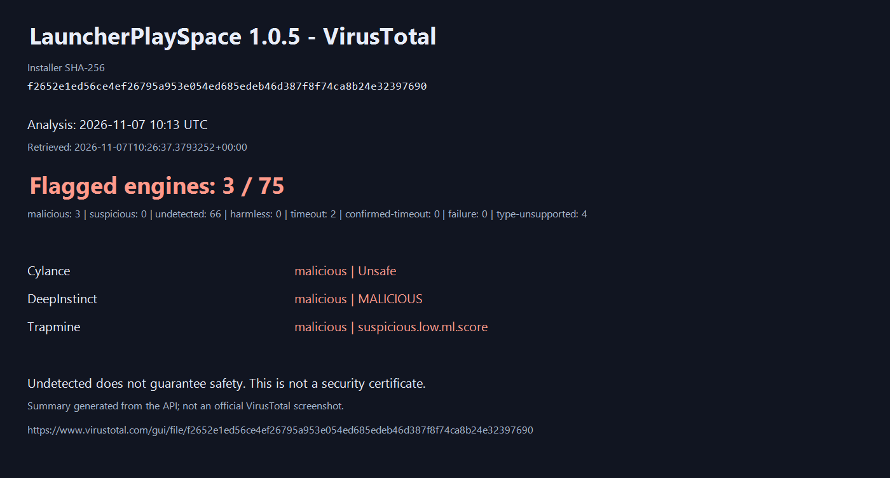

# VirusTotal: установщик LauncherPlaySpace 1.0.5

Проверен SHA-256 `f2652e1ed56ce4ef26795a953e054ed685edeb46d387f8f74ca8b24e32397690` — опубликованный `LauncherPlaySpace-1.0.5-Setup.exe`.

Дата анализа: **07.11.2026, 10:13 UTC (13:13 МСК)**. Дата получения ответа API указана в JSON и на изображении. Это снимок результатов, а не постоянно обновляемый статус.

| Категория API | Количество |
| --- | ---: |
| Malicious | 3 |
| Suspicious | 0 |
| Undetected | 66 |
| Timeout | 2 |
| Type unsupported | 4 |

Срабатывания: **Cylance — Unsafe; DeepInstinct — MALICIOUS; Trapmine — suspicious.low.ml.score**. Названия приведены по ответу API. Причины срабатываний и их ложноположительность не установлены. Undetected не означает доказанную безопасность; тайм-ауты и неподдерживаемые типы не считаются успешными проверками.

- [Оригинальный отчёт VirusTotal](https://www.virustotal.com/gui/file/f2652e1ed56ce4ef26795a953e054ed685edeb46d387f8f74ca8b24e32397690)
- [JSON: результаты всех движков](virustotal-1.0.5-installer.json)

Изображение создано из ответа API, это не официальный скриншот VirusTotal и не сертификат безопасности. Проверка относится к установщику; она не заменяет отдельный анализ EXE приложения или устанавливаемых пользователем модов. Исходный ответ API хранится локально; ключ не публикуется. Повторная загрузка файла и повторный анализ не запрашивались.
